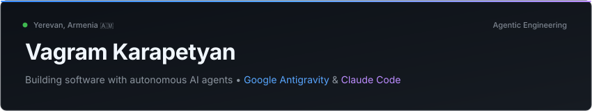

  <a href="README.ru.md"><code>🇷🇺 Русский</code></a> &nbsp;•&nbsp; <b><code>🇬🇧 English</code></b>

<!-- Header Banner -->

  

 

> **Software builder focused on TypeScript systems, Chromium extensions, and autonomous agent workflows.**  
> Based in Yerevan, Armenia 🇦🇲 • Studying Economics & Systems at Plekhanov University.  
> Engineering agentic architectures with **Google Antigravity** & **Claude Code**.

---

### 🛠 Projects & Engineering Case Studies

#### 🔮 [Prism Tabs](https://github.com/vagram-karapetyan/prism-tabs) — Dual-Engine Chromium MV3 Tab Grouping Extension
* **The Problem:** Cognitive overhead and browser degradation when juggling 80+ open tabs across active research and development tasks.
* **The Architecture:** Strict **Ports & Adapters** core (`domain`, `ports`, `engine`, `application` isolated from `chrome.*` and DOM via ESLint boundaries):
  * **Logic Mode (default):** `< 10 ms`, 100% offline deterministic clustering combining custom rules, platform buckets, `openerTabId` lineage, RU/EN NLP, `Smart Merge`, and `maxTabsPerGroup` splitting.
  * **Meaning Mode (BYOK AI):** Optional semantic grouping (Groq, Gemini, or custom OpenAI-compatible API) behind a pre-flight URL sanitizer with automatic fallback to Logic Mode.
  * **Zero-Telemetry MV3 Runtime:** Minimal permissions (`tabs`, `tabGroups`, `storage`), atomic sort + `Undo` (`Ctrl+Z`), and `432×564` Preact + Signals popup with local-only storage.
* **Stack:** `TypeScript`, `Chrome Extensions (MV3)`, `Preact 10`, `@preact/signals`, `Vite`, `Vitest`.

#### ⚔️ [Quest Forge](https://github.com/vagram-karapetyan/quest-forge) — Nonlinear Text RPG Platform & 2D Scene-Graph Builder
* **The Problem:** Branching narratives, typed state machines, and multi-target delivery (web player + offline export) quickly break down when modeled in plain text or coupled UI/server logic.
* **The Architecture:** npm workspaces TypeScript monorepo sharing a deterministic core across server, web, and standalone targets:
  * **Shared Engine (`@quest-forge/engine`):** Zod v2 schemas, deterministic runtime (inventory, typed variables, conditions/effects, 50-step undo), BFS playability analyzer, and BFS auto-layout.
  * **2D Builder & Web Runtime:** React 19 + Vite visual scene-graph editor and web player backed by a Fastify 5 + SQLite (`better-sqlite3`, Drizzle ORM) REST API with author auth and Docker support.
  * **Standalone HTML Compiler (`@quest-forge/standalone`):** Bundles quests via `esbuild` into self-contained offline HTML players with `localStorage` persistence and hotkeys.
* **Stack:** `TypeScript`, `React 19`, `Fastify 5`, `SQLite (Drizzle ORM)`, `Zod`, `Vite`, `esbuild`.

---

### ⚙️ Technical Focus

* 🤖 **Agentic Systems:** Autonomous multi-agent orchestration, prompt & skill architecture, tool-calling pipelines (**Google Antigravity**, **Claude Code**).
* 🌐 **Frontend & Extensions:** TypeScript, React 19, Preact, Chrome Extensions (Manifest V3), Vite, HTML5 / CSS3.
* ⚡ **Backend, Data & Tooling:** Node.js, Fastify, SQLite, Drizzle ORM, REST APIs, Vitest, Playwright, Docker, Git.

---

### ♟️ Beyond the Terminal

* ♟️ **Chess:** Active player on Lichess with a **~2200 peak rating** (blitz & rapid).
* 🎸 **Music:** Heavy rock & metal.

---

### 📊 Activity & Telemetry

  
  &nbsp;
  

---

### 📬 Contact & Links

  
  &nbsp;
  
  &nbsp;
  

