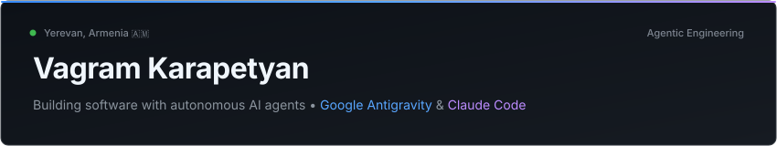

  <a href="README.ru.md"><code>🇷🇺 Русский</code></a> &nbsp;•&nbsp; <b><code>🇬🇧 English</code></b>

<!-- Header Banner -->

  

 

> **Software builder focused on browser extensions, asynchronous backend systems, and autonomous agent workflows.**  
> Based in Yerevan, Armenia 🇦🇲 • Studying Economics & Systems at Plekhanov University.  
> Engineering agentic architectures with **Google Antigravity** & **Claude Code**.

---

### 🛠 Projects & Engineering Case Studies

#### 🔮 [Prism Tabs](https://github.com/vagram-karapetyan/prism-tabs) — Intelligent Chrome Tab Grouping Engine
* **The Problem:** Cognitive overhead and browser degradation when juggling 80+ open tabs across active research and development tasks.
* **The Architecture:** Dual-engine architecture designed for instant client-side performance:
  * Sub-millisecond deterministic heuristics for immediate domain clustering.
  * Local semantic grouping via BYOK LLM integrations for nuanced category extraction.
  * Strict zero-telemetry design with persistent state stored exclusively in local extension storage.
* **Stack:** `TypeScript`, `Chrome Extensions (Manifest V3)`, `TailwindCSS`, `Web APIs`.

#### ⚔️ [Quest Forge](https://github.com/vagram-karapetyan/quest-forge) — Visual Interactive Story Engine & Node Constructor
* **The Problem:** Non-linear narratives and state machines quickly become unmaintainable when modeled in plain text or rigid hierarchy trees.
* **The Architecture:** Directed Acyclic Graph (DAG) state machine:
  * Interactive canvas editor built in pure Vanilla JS, avoiding heavy UI framework overhead.
  * Asynchronous backend powered by FastAPI handling instant state validation and graph traversal.
* **Stack:** `Python`, `FastAPI`, `Vanilla JavaScript`, `Canvas / DOM APIs`.

---

### 📦 Recent Repositories & Activity

<!-- RECENT_REPOS:START -->
* [**prism-tabs**](https://github.com/vagram-karapetyan/prism-tabs) — Prism Tabs — A fast, privacy-first Chromium MV3 extension that eliminates tab overload through Dual-Engine grouping (instant offline Logic Mode + BYOK AI Meaning Mode). (`TypeScript` • ⭐ 1)
* [**quest-forge**](https://github.com/vagram-karapetyan/quest-forge) — Visual interactive story engine & node-based quest constructor built with FastAPI and Vanilla JS (`TypeScript` • ⭐ 1)
<!-- RECENT_REPOS:END -->

---

### ⚙️ Technical Focus

* 🤖 **Agentic Systems:** Autonomous multi-agent orchestration, prompt architecture, tool-calling pipelines (**Google Antigravity**, **Claude Code**).
* 🌐 **Frontend & Extensions:** TypeScript, JavaScript, Chrome Extensions (Manifest V3), Canvas / DOM APIs, HTML5 / CSS3.
* ⚡ **Backend & Systems:** Python, FastAPI, asynchronous architecture, REST APIs, Git.

---

### ♟️ Beyond the Terminal

* ♟️ **Chess:** Active player on Lichess with a **~2200 peak rating** (blitz & rapid).
* 🎸 **Music:** Heavy rock & metal.

---

### 📊 Activity & Telemetry

  
  &nbsp;
  

---

### 📬 Contact & Links

  
  &nbsp;
  
  &nbsp;
  

