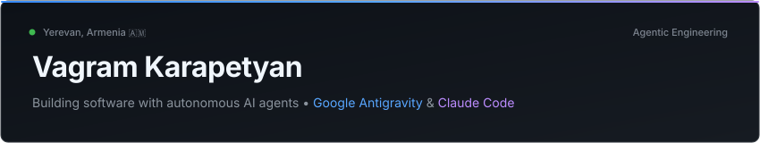

  <b><code>🇷🇺 Русский</code></b> &nbsp;•&nbsp; <a href="README.md"><code>🇬🇧 English</code></a>

<!-- Header Banner -->

  

 

> **Разработчик программных продуктов: браузерные расширения, асинхронные бэкенд-системы и автономные агентные пайплайны.**  
> Ереван, Армения 🇦🇲 • Студент РЭУ им. Г.В. Плеханова (Ереванский филиал).  
> Проектирую и создаю архитектуры с помощью автономных ИИ-агентов в **Google Antigravity** и **Claude Code**.

---

### 🛠 Проекты и инженерные кейсы

#### 🔮 [Prism Tabs](https://github.com/vagram-karapetyan/prism-tabs) — Интеллектуальный движок группировки вкладок для Chrome
* **Проблема:** Когнитивная перегрузка и падение производительности браузера при 80+ открытых вкладках во время исследовательской и продуктовой работы.
* **Архитектура:** Двухуровневая система (Dual-Engine) с минимальной нагрузкой на клиент:
  * Субмиллисекундные детерминированные эвристики для мгновенной группировки по доменам.
  * Локальная семантическая классификация через BYOK LLM для смысловой категоризации.
  * Строгая конфиденциальность: zero-telemetry, персистентное состояние хранится исключительно в локальном хранилище расширения.
* **Стек:** `TypeScript`, `Chrome Extensions (Manifest V3)`, `TailwindCSS`, `Web APIs`.

#### ⚔️ [Quest Forge](https://github.com/vagram-karapetyan/quest-forge) — Визуальный конструктор и движок нелинейных историй
* **Проблема:** Нелинейные сценарии и конечные автоматы (state machines) быстро теряют управляемость при описании текстом или в жёстких иерархических деревьях.
* **Архитектура:** Направленный ациклический граф (DAG) состояний:
  * Интерактивный редактор графов на чистом Vanilla JS (Canvas/DOM) без тяжёлых UI-фреймворков.
  * Асинхронное ядро на FastAPI для валидации состояний и мгновенного перехода по графу.
* **Стек:** `Python`, `FastAPI`, `Vanilla JavaScript`, `Canvas / DOM APIs`.

---

### 📦 Недавние репозитории

<!-- RECENT_REPOS:START -->
* [**prism-tabs**](https://github.com/vagram-karapetyan/prism-tabs) — Prism Tabs — A fast, privacy-first Chromium MV3 extension that eliminates tab overload through Dual-Engine grouping (instant offline Logic Mode + BYOK AI Meaning Mode). (`TypeScript` • ⭐ 1)
* [**quest-forge**](https://github.com/vagram-karapetyan/quest-forge) — Visual interactive story engine & node-based quest constructor built with FastAPI and Vanilla JS (`TypeScript` • ⭐ 1)
<!-- RECENT_REPOS:END -->

---

### ⚙️ Технический фокус

* 🤖 **Агентные системы:** Оркестрация автономных мультиагентных пайплайнов, архитектура промптов, интеграция tool-calling (**Google Antigravity**, **Claude Code**).
* 🌐 **Фронтенд и расширения:** TypeScript, JavaScript, Chrome Extensions (Manifest V3), Canvas / DOM APIs, HTML5 / CSS3.
* ⚡ **Бэкенд и инфраструктура:** Python, FastAPI, асинхронная архитектура, REST APIs, Git.

---

### ♟️ За пределами терминала

* ♟️ **Шахматы:** Активно играю в блиц и рапид на Lichess с **пиковым рейтингом ~2200**.
* 🎸 **Музыка:** Рок и метал.

---

### 📊 Активность

  
  &nbsp;
  

---

### 📬 Связь и ссылки

  
  &nbsp;
  
  &nbsp;
  

