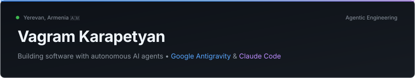

  <b><code>🇷🇺 Русский</code></b> &nbsp;•&nbsp; <a href="README.md"><code>🇬🇧 English</code></a>

<!-- Header Banner -->

  

 

> **Разработчик программных продуктов: TypeScript-системы, расширения для Chromium и автономные агентные пайплайны.**  
> Ереван, Армения 🇦🇲 • Студент РЭУ им. Г.В. Плеханова (Ереванский филиал).  
> Проектирую и создаю архитектуры с помощью автономных ИИ-агентов в **Google Antigravity** и **Claude Code**.

---

### 🛠 Проекты и инженерные кейсы

#### 🔮 [Prism Tabs](https://github.com/vagram-karapetyan/prism-tabs) — Двухдвижковое расширение группировки вкладок (Chromium MV3)
* **Проблема:** Когнитивная перегрузка и деградация браузера при 80+ открытых вкладках во время исследовательской и продуктовой работы.
* **Архитектура:** Строгая **Ports & Adapters** архитектура (ядро `domain`, `ports`, `engine`, `application` изолировано от `chrome.*` и DOM правилами ESLint):
  * **Logic Mode (по умолчанию):** `< 10 мс`, 100% оффлайн-кластеризация на правилах, платформенных бакетах, цепочках `openerTabId`, RU/EN NLP, `Smart Merge` и сплиттере `maxTabsPerGroup`.
  * **Meaning Mode (BYOK AI):** Опциональная семантическая группировка (Groq, Gemini или OpenAI-compatible API) через встроенный URL-санитайзер с автооткатом в Logic Mode.
  * **Zero-Telemetry MV3 Runtime:** Минимальные права (`tabs`, `tabGroups`, `storage`), атомарная сортировка с `Undo` (`Ctrl+Z`) и popup `432×564` на Preact + Signals с локальным хранением данных.
* **Стек:** `TypeScript`, `Chrome Extensions (MV3)`, `Preact 10`, `@preact/signals`, `Vite`, `Vitest`.

#### ⚔️ [Quest Forge](https://github.com/vagram-karapetyan/quest-forge) — Платформа нелинейных текстовых квестов и 2D-редактор сцен
* **Проблема:** Ветвящиеся сценарии, типизированные состояния и кросс-платформенная доставка (веб-плеер + оффлайн-экспорт) быстро теряют управляемость при описании текстом или жёсткой связке UI и сервера.
* **Архитектура:** TypeScript-монорепозиторий (npm workspaces) с общим детерминированным ядром для сервера, веба и оффлайн-сборки:
  * **Общее ядро (`@quest-forge/engine`):** Zod v2-схемы, детерминированный рантайм (инвентарь, типизированные переменные, условия/эффекты, откат до 50 шагов), BFS-анализатор проходимости и авто-раскладка графа.
  * **2D-конструктор и веб-рантайм:** Визуальный редактор графа сцен и веб-плеер на React 19 + Vite поверх REST API на Fastify 5 + SQLite (`better-sqlite3`, Drizzle ORM) с авторской авторизацией и Docker.
  * **Компилятор оффлайн-HTML (`@quest-forge/standalone`):** Сборка квестов через `esbuild` в автономный однофайловый HTML-плеер с сохранением в `localStorage` и горячими клавишами.
* **Стек:** `TypeScript`, `React 19`, `Fastify 5`, `SQLite (Drizzle ORM)`, `Zod`, `Vite`, `esbuild`.

---

### ⚙️ Технический фокус

* 🤖 **Агентные системы:** Оркестрация автономных мультиагентных пайплайнов, архитектура промптов и скиллов, tool-calling (**Google Antigravity**, **Claude Code**).
* 🌐 **Фронтенд и расширения:** TypeScript, React 19, Preact, Chrome Extensions (Manifest V3), Vite, HTML5 / CSS3.
* ⚡ **Бэкенд, данные и тулинг:** Node.js, Fastify, SQLite, Drizzle ORM, REST APIs, Vitest, Playwright, Docker, Git.

---

### ♟️ За пределами терминала

* ♟️ **Шахматы:** Активно играю в блиц и рапид на Lichess с **пиковым рейтингом ~2200**.
* 🎸 **Музыка:** Рок и метал.

---

### 📊 Активность

  
  &nbsp;
  

---

### 📬 Связь и ссылки

  
  &nbsp;
  
  &nbsp;
  

